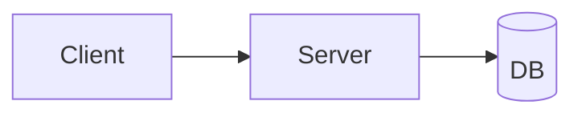

# ARCHITECTURE

<!-- 프로젝트 초기 설정 태스크에서 에이전트가 채운다. 구조나 주요 결정이 바뀔 때마다 갱신한다. -->
<!-- Profile의 Type이 Script면 3·5·6은 생략해도 된다. -->

## 1. 개요
<!-- 이 시스템이 무엇을 하는지 2~3줄. 어디까지가 이 저장소의 책임이고 무엇이 바깥(외부 API, 기존 서비스)인지. -->

## 2. 기술 스택
<!-- 해당 없는 행은 삭제. Web + Mobile이면 클라이언트별로 행을 나눈다. -->
| 영역 | 선택 | 이유 |
|---|---|---|
| 언어 | | |
| 프레임워크 | | |
| 데이터 저장 | | |
| 빌드·패키징 | | |
| 테스트 | | |
| 호스팅·배포 | | |

## 3. 시스템 구성도
<!-- 주요 구성요소와 그 사이의 통신. Server 있음이면 클라이언트 / 서버 / 저장소 / 외부 서비스를 구분한다. -->


## 4. 디렉터리 구조
<!-- 최상위 2단계까지. 각 디렉터리에 한 줄 설명. -->
```
src/
  ...
```

## 5. 모듈·레이어와 의존 방향
<!-- 어떤 계층이 있고, 의존은 어느 방향으로만 허용되는지. 예: UI → 서비스 → 저장소, 역방향 금지. -->
| 레이어·모듈 | 책임 | 의존 가능 대상 |
|---|---|---|

## 6. 핵심 흐름
<!-- 가장 대표적인 요청·동작 1~2개를 단계별로. 이 흐름을 따라가면 코드 구조가 이해되는 것으로 고른다. -->
### 6.1 [흐름 이름]
1.

## 7. 설계 결정 기록
<!-- 되돌리기 어렵거나 나중에 "왜 이렇게 했지?"가 나올 결정만. 최신이 위. 결정을 뒤집을 때는 지우지 말고 새 행을 추가한다. -->
| 날짜 | 결정 | 이유 | 버린 대안 |
|---|---|---|---|
